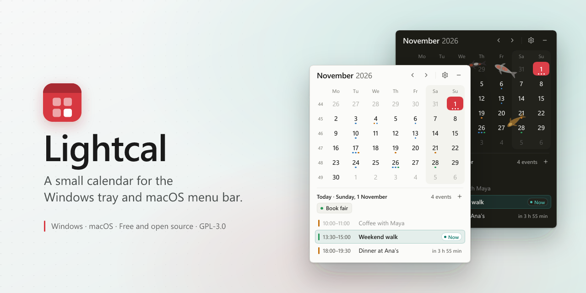
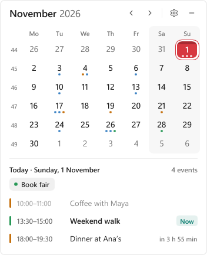
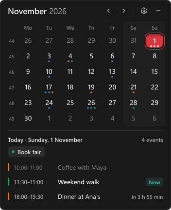
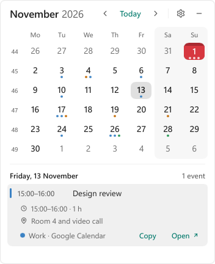
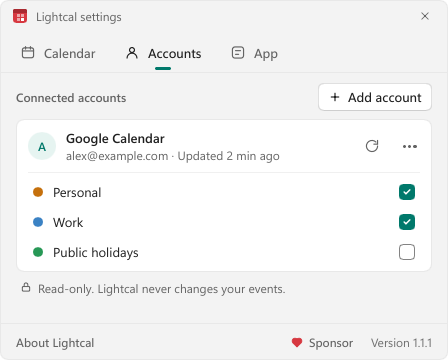
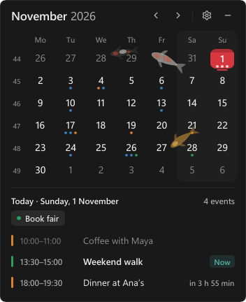
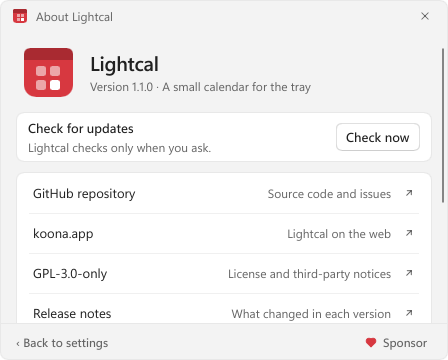

# Lightcal

Lightcal 1.3.3 is a small calendar that lives in the Windows tray and the macOS menu bar. Click its icon, or press your own shortcut, to see the month, the days that have events and today's agenda. Connect Google, Outlook or private ICS calendars if you want them: Lightcal only reads them, works without an account of its own and sends no telemetry. It is written in Rust and [Slint](https://slint.dev), with no browser engine inside.

## Highlights

- **Month at a glance.** Open the 42-day month from the tray or the taskbar. Move by month, jump back with **Today**, or use the keyboard. Week numbers and shaded weekend columns are optional.
- **Event dots and agenda.** Up to three dots per day in calendar colors. The agenda lists all-day events, time ranges, **Now** and the time to the next event. Click an event for its duration, location and calendar, with **Copy** and, for Google and Outlook, **Open** in the web calendar.
- **Your calendars, read-only.** Google Calendar, Outlook (Microsoft Graph), private HTTPS ICS links and, optionally, calendars exposed by Windows. On a Mac: Google, Outlook and the calendars in macOS Calendar. Choose which calendars to show. Lightcal never changes an event.
- **Date icon.** The Windows tray shows today's date in Lightcal's coral tile or a mono outline, with weekday or time variants. On a Mac, the menu bar shows the date with an optional weekday and month, and the Dock icon shows today's date. Lightcal does not replace the system clock.
- **Ten languages.** English, German, Spanish, French, Brazilian Portuguese, Russian, Ukrainian, Japanese, Korean and Simplified Chinese, switched without a restart.
- **Light and dark.** Follows the system or stays on the theme you choose.
- **Opt-in extras.** A global shortcut and opening at login are off until you turn them on.
- **Signed updates.** Lightcal checks GitHub once a day for a newer release (you can turn this off in About) and installs only signed updates: Authenticode on Windows, Sparkle with a notarized app on macOS.

## Screenshots

| Today, light | Today, dark |
| :---: | :---: |
|  |  |
| **Event details** | **Accounts** |
|  |  |
| **Koi pond** | **About** |
|  |  |

These are headless renders of the real Slint UI (`--render-snapshots`) with sample events; no account was used.

## Install

Download Lightcal from [GitHub Releases](https://github.com/andmetoo/lightcal/releases).

**Windows 10 and 11 (x64)**

- `lightcal-X.Y.Z-windows-x64-setup.exe`, a per-user installer that needs no administrator rights;
- `lightcal-vX.Y.Z-windows-x64.zip`, a portable copy;
- `lightcal.exe`, the application the updater uses.

Windows releases are Authenticode-signed on the maintainer's PC, and the signatures are verified before a release is published. See [Windows installer](docs/windows-installer.md) for what Setup installs, how signing works and how in-place updates are restricted to signed builds.

**macOS 14 or later (Apple Silicon and Intel)**

- `lightcal-X.Y.Z-macos-universal.dmg`: open it and drag Lightcal to Applications;
- `lightcal-X.Y.Z-macos-universal.zip`, the app the Sparkle updater installs.

The Mac app is signed with a Developer ID and notarized by Apple, so it opens without Gatekeeper warnings. See [macOS build and distribution](docs/macos.md).

Every file has a SHA-256 checksum next to it. CI artifacts from pull requests are unsigned review builds.

## On a Mac

Lightcal runs on macOS 14 or later, on Apple Silicon and Intel, as one universal app. It opens from the menu bar or the Dock, reads Google and Outlook directly and the calendars of macOS Calendar through EventKit, and stores sign-ins in the Keychain. The On this PC calendar and private ICS links are Windows-only; create Mac events in Calendar instead. See [macOS](docs/macos.md) and [ADR 0019](docs/decisions/0019-macos-support.md).

## Build from source

You need Rust (stable), [Bun](https://bun.sh) and a current [just](https://github.com/casey/just).

```powershell
just check            # docs, script tests, rustfmt, Clippy and tests
just run              # run Lightcal
just run-demo         # run with sample events only
just release build    # locked release build
just installer        # macOS DMG in target/macos; Windows NSIS setup in target/nsis
```

Headless renders need no display and make no network requests:

```powershell
cargo run -p lightcal --locked -- --render-snapshots target/snapshots
```

Copy [.env.example](.env.example) to the ignored `.env` for the public client ids and the update certificate pin. Signing and publishing are described in [Windows installer](docs/windows-installer.md) and [provider setup](docs/provider-setup.md). The README banner is drawn by `bun scripts/render-banner.ts`.

## Privacy

Lightcal never changes your connected calendars and has no telemetry. It goes online only to read the calendars you connect (from Google, Microsoft or the ICS host) and to check GitHub for updates. Sign-in tokens stay in the Windows protected store, or in the macOS Keychain on a Mac. macOS Calendar events are read on the Mac through EventKit, after you allow access. Events you create in the On this PC calendar are saved only on this PC, as plain unencrypted JSON (`local-events.json` in `%APPDATA%\Lightcal`), so anyone with access to your Windows profile can read them. See [required features](docs/features.md).

## Documentation

[Documentation index](docs/README.md) · [Required features](docs/features.md) · [Provider setup](docs/provider-setup.md) · [Windows installer](docs/windows-installer.md) · [macOS](docs/macos.md) · [Design](design/README.md) · [Contributing](CONTRIBUTING.md)

## Support

Lightcal is free and open source. If it is useful to you, you can [sponsor its development on GitHub](https://github.com/sponsors/andmetoo), monthly or [one time](https://github.com/sponsors/andmetoo?frequency=one-time).

## License

Lightcal is licensed under [GPL-3.0-only](LICENSE). Copyright (c) 2026 Lightcal contributors.
