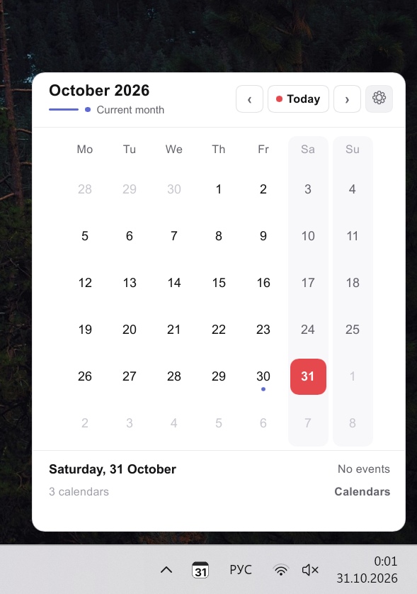

# Lightcal

A compact calendar for Windows. Open the month from the tray or the taskbar, without a browser and without a required account.


The calendar is 352 by 432 logical pixels. Settings use a separate 448 by 360 window. English is the default, with Russian, Spanish, and Japanese included.




The Windows capture is the running application on 31 October 2026. The theme renders above are the same window, drawn by the app with sample events.

## Download

Windows builds are published on [GitHub Releases](https://github.com/andmetoo/lightcal/releases). A stable tag `vX.Y.Z` is the version shown in About and in the Windows file properties. Untagged builds keep the Cargo workspace version.

Pushing a stable tag attaches the unsigned Windows build to its GitHub release, creating a draft if needed. Existing draft, prerelease, and public releases are supported. The maintainer runs `just sign-draft vX.Y.Z` on Windows with Certum SimplySign Desktop signed in; it replaces the files with signed builds and preserves release visibility. `just publish-release vX.Y.Z` verifies the attached signatures before explicitly publishing/promoting the release. Signed in-place installation needs a build-configured certificate pin and a valid signed `lightcal.exe`; an unsigned build is never installed in place. Without the pin, **Download** opens the newer release page. See [Windows release instructions](docs/windows-installer.md) and [provider and signing setup](docs/provider-setup.md).

## Features

- Month navigation, Today, and keyboard movement on the 42-day grid.
- Tray icon modes for the date, weekday and date, or time and date. The icon is Lightcal's; it does not replace the Windows clock.
- Optional read-only Outlook (Microsoft Graph) and private HTTPS ICS calendars. Event dots are capped at three per day.
- Startup and a global shortcut stay off until you turn them on.

## Build

Rust and [just](https://github.com/casey/just) are required.

```powershell
just check
just release build
just installer
```

`just run-demo` needs a display and uses sample events. Headless renders do not use the network:

```powershell
cargo run -p lightcal --locked -- --render-snapshots target/snapshots
```

Signing, NSIS, and GitHub publication are described in [Windows installer](docs/windows-installer.md). Copy [.env.example](.env.example) to the ignored `.env` for the public client ids and the update certificate pin.

## Privacy

Lightcal has no telemetry and no account of its own. It contacts the network only when you act: a manual update check reaches GitHub, an Outlook or Google calendar you connect reaches Microsoft or Google with read-only access, and a private ICS URL you add is fetched from that host. Tokens are kept in the Windows protected store. See [required features](docs/features.md) and [provider setup](docs/provider-setup.md).

## Platforms

Lightcal is Windows only. CI also compiles and tests the portable calendar logic on Linux.

## Documentation

[Documentation index](docs/README.md) · [Required features](docs/features.md) · [Contributing](CONTRIBUTING.md)

## License

Lightcal is licensed under [GPL-3.0-only](LICENSE). Copyright (c) 2026 Lightcal contributors.
