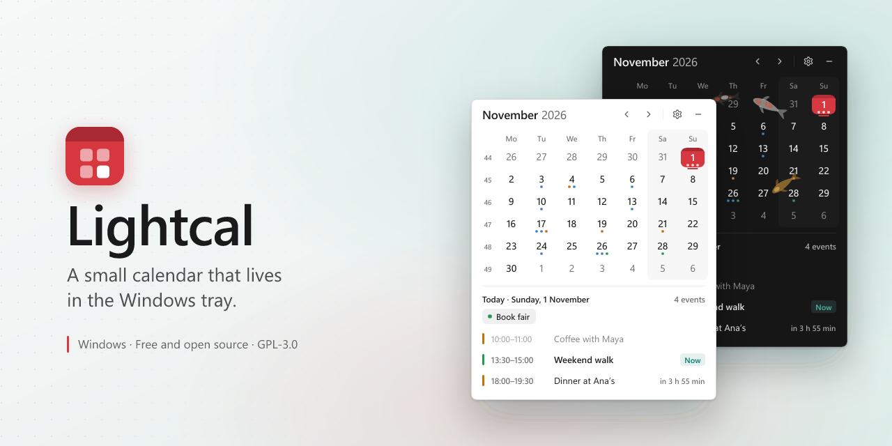
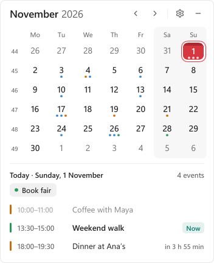
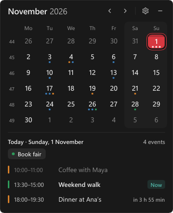
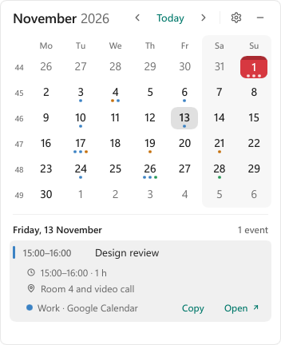
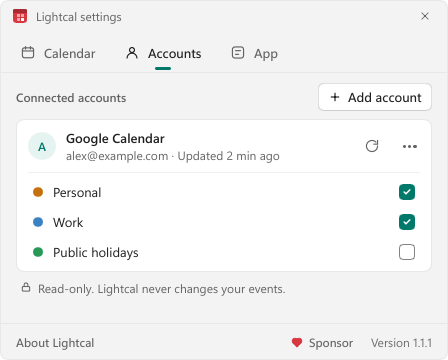
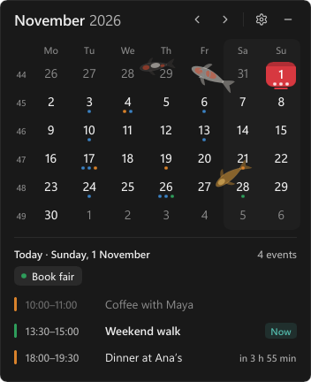
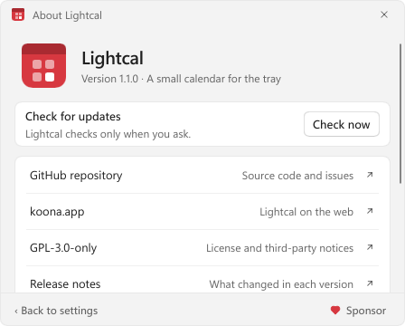

# Lightcal

Lightcal 1.1.2 is a small calendar that lives in the Windows tray. Click the tray icon, or press your own shortcut, to see the month, the days that have events and today's agenda. Connect Google, Outlook or private ICS calendars if you want them: Lightcal only reads them, works without an account of its own and sends no telemetry. It is written in Rust and [Slint](https://slint.dev), with no browser engine inside.

## Highlights

- **Month at a glance.** Open the 42-day month from the tray or the taskbar. Move by month, jump back with **Today**, or use the keyboard. Week numbers and shaded weekend columns are optional.
- **Event dots and agenda.** Up to three dots per day in calendar colors. The agenda lists all-day events, time ranges, **Now** and the time to the next event. Click an event for its duration, location and calendar, with **Copy** and, for Google and Outlook, **Open** in the web calendar.
- **Your calendars, read-only.** Google Calendar, Outlook (Microsoft Graph), private HTTPS ICS links and, optionally, calendars exposed by Windows. Choose which calendars to show. Lightcal never changes an event.
- **Tray date icon.** The tray shows today's date in Lightcal's coral tile or a mono outline, with weekday or time variants. It does not replace the Windows clock.
- **Ten languages.** English, German, Spanish, French, Brazilian Portuguese, Russian, Ukrainian, Japanese, Korean and Simplified Chinese, switched without a restart.
- **Light and dark.** Follows Windows or stays on the theme you choose.
- **Opt-in extras.** A global shortcut and start with Windows are off until you turn them on.
- **Updates on request.** **Check for updates** compares your version with the latest GitHub release only when you ask.

## Screenshots

| Today, light | Today, dark |
| :---: | :---: |
|  |  |
| **Event details** | **Accounts** |
|  |  |
| **Koi pond** | **About** |
|  |  |

These are headless renders of the real Slint UI (`--render-snapshots`) with sample events; no account was used.

## Install

Download Lightcal from [GitHub Releases](https://github.com/andmetoo/lightcal/releases). Each release has:

- `lightcal-X.Y.Z-windows-x64-setup.exe`, a per-user installer that needs no administrator rights;
- `lightcal-vX.Y.Z-windows-x64.zip`, a portable copy;
- `lightcal.exe`, the application the updater uses.

Every file has a SHA-256 checksum next to it. Releases are Authenticode-signed on the maintainer's PC, and the signatures are verified before a release is published. CI artifacts are unsigned until then. See [Windows installer](docs/windows-installer.md) for what Setup installs, how signing works and how in-place updates are restricted to signed builds.

## Build from source

You need Rust (stable), [Bun](https://bun.sh) and a current [just](https://github.com/casey/just).

```powershell
just check            # docs, script tests, rustfmt, Clippy and tests
just run              # run Lightcal
just run-demo         # run with sample events only
just release build    # locked release build
just installer        # NSIS setup in target/nsis
```

Headless renders need no display and make no network requests:

```powershell
cargo run -p lightcal --locked -- --render-snapshots target/snapshots
```

Copy [.env.example](.env.example) to the ignored `.env` for the public client ids and the update certificate pin. Signing and publishing are described in [Windows installer](docs/windows-installer.md) and [provider setup](docs/provider-setup.md). The README banner is drawn by `bun scripts/render-banner.ts`.

## Privacy

Lightcal is read-only and has no telemetry. It goes online only when you act: a calendar you connect is read from Google, Microsoft or the ICS host, and an update check reaches GitHub. Sign-in tokens stay in the Windows protected store. See [required features](docs/features.md).

## Documentation

[Documentation index](docs/README.md) · [Required features](docs/features.md) · [Provider setup](docs/provider-setup.md) · [Windows installer](docs/windows-installer.md) · [Design](design/README.md) · [Contributing](CONTRIBUTING.md)

## Support

Lightcal is free and open source. If it is useful to you, you can [sponsor its development on GitHub](https://github.com/sponsors/andmetoo), monthly or [one time](https://github.com/sponsors/andmetoo?frequency=one-time).

## License

Lightcal is licensed under [GPL-3.0-only](LICENSE). Copyright (c) 2026 Lightcal contributors.
