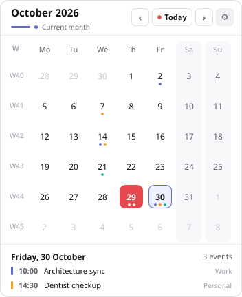
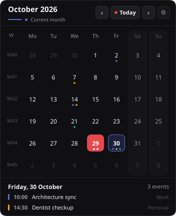
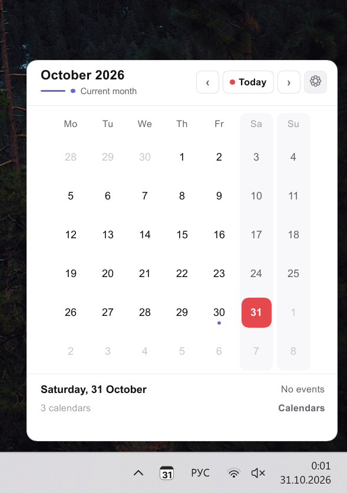

# Lightcal

A compact calendar for Windows. Open the month from the tray or the taskbar, without a browser and without a required account.



The calendar is 352 by 432 logical pixels. Settings use a separate 448 by 360 window. English is the default, with Russian, Spanish, and Japanese included.





The Windows capture is the running application on 31 October 2026. The theme renders above are the same window, drawn by the app with sample events.

## Download

Windows builds are published on [GitHub Releases](https://github.com/andmetoo/lightcal/releases). A stable tag `vX.Y.Z` is the version shown in About and in the Windows file properties. Untagged builds keep the Cargo workspace version.

Pushing a stable tag opens an unsigned draft. That draft is not listed as a download, and Lightcal does not install it. Releases already published stay listed. The maintainer signs the draft executable on Windows with `signtool` while Certum SimplySign Desktop is signed in, and publishes the release afterwards. A published release includes a signed `lightcal.exe`. Signed in-place installation is a separate opt-in: it needs a build-configured certificate pin and that signed asset. Without the pin, **Download** opens the newer release page. See [provider and signing setup](docs/provider-setup.md).

## Features

- Month navigation, Today, and keyboard movement on the 42-day grid.
- Tray icon modes for the date, weekday and date, or time and date. The icon is Lightcal's; it does not replace the Windows clock.
- Optional read-only Outlook (Microsoft Graph) and private HTTPS ICS calendars. Event dots are capped at three per day.
- Startup and a global shortcut stay off until you turn them on.

## Build

Rust and [just](https://github.com/casey/just) are required.

```powershell
just check
just build-release
just build-installer
```

`just run-demo` needs a display and uses sample events. Headless renders do not use the network:

```powershell
cargo run -p lightcal --locked -- --render-snapshots target/snapshots
```

Signing, NSIS, and GitHub publication are described in [Windows installer](docs/windows-installer.md). Copy [.env.example](.env.example) to the ignored `.env.local` for the public Microsoft client id and the update certificate pin.

## Documentation

[Documentation index](docs/README.md) · [Required features](docs/features.md) · [Contributing](CONTRIBUTING.md)

## License

Lightcal is licensed under [GPL-3.0-only](LICENSE). Copyright (c) 2026 Lightcal contributors.
